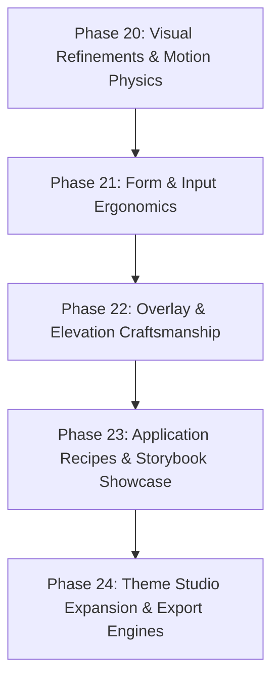

# Pine UI — UI/UX Evolution & System Refinement Plan
**Author:** Principal UI Systems Engineer  
**Status:** Proposed Architecture & Execution Roadmap  
**Document:** `next.md`  

---

## Executive Summary

Pine UI has completed its core functional foundation across Phases 1–19, featuring headless behaviors, zero WCAG AA accessibility violations, StyleX tokens, and multi-tier components. 

To transform Pine UI from a **functional component library** into an **industry-defining, world-class design system** (on par with Linear, Vercel/Geist, Radix, and Apple HIG), we must elevate both the **Visual & Interaction Craftsmanship (UI)** and the **System Ergonomics & Developer Experience (UX)**.

This document establishes our multi-phase blueprint for UI/UX superiority.

---

## 1. Visual Craftsmanship & Aesthetic Architecture (UI)

### 1.1 Multi-Layered Elevation & Ambient Lighting (Depth)
* **Current State:** Single-layer box shadows that appear flat in dark mode.
* **Target Architecture:**
  * **Dual-layer Diffuse Shadows:** Separate directional light source (`shadow-color` + 10–25% spread) and ambient occlusion (`rgba(0,0,0,0.04)` contact shadow).
  * **Dark Mode Luminescence:** In dark mode, shadows disappear. Replace with **subtle 1px inner borders** (`inset 0 1px 0 0 rgba(255, 255, 255, 0.08)`) and surface elevation brightness stepping (Level 1: `#0d1117`, Level 2: `#161b22`, Level 3: `#21262d`).
  * **Glassmorphism & Frosted Surfaces:** Implement `backdrop-filter: blur(12px) saturate(180%)` across Overlays, Drawers, Headers, and Floating Command Palettes.

### 1.2 Fluid Micro-Interactions & Spring Motion Physics
* **Current State:** Linear/CSS ease transitions on background colors and opacity.
* **Target Architecture:**
  * **Spring Physics Curvature:** Adopt cubic bezier curves mimicking physical inertia:
    * Standard Entrance: `cubic-bezier(0.16, 1, 0.3, 1)` (smooth deceleration).
    * Micro-scale press response: `transform: scale(0.98)` on button active state with `transition: transform 0.08s ease-out`.
  * **Animated State Entry/Exit:**
    * Dropdown Menus, Selects & Popovers: Subtle slide-in + zoom (`scale(0.96) translateY(-4px)` $\rightarrow$ `scale(1) translateY(0)` with opacity fade).
    * Modals & Dialogs: Smooth backdrop veil transition with inward dimensional pop.
    * Tabs & Segmented Controls: Sliding pill indicator with spring easing when switching active tabs.
  * **Respect `prefers-reduced-motion`:** Fallback seamlessly to zero-motion opacity dissolves for accessibility.

### 1.3 High-Precision Typography & Numeric Formatting
* **Current State:** Standard system sans font metrics.
* **Target Architecture:**
  * **Tabular Figures:** Enforce `font-variant-numeric: tabular-nums` across DataGrid, DatePicker, Badges, Pagination, and metric displays to eliminate horizontal jitter during live updates.
  * **Optical Kerning & Letter Spacing:** Apply micro-tracking tokens (`letter-spacing: -0.015em` on headlines, `letter-spacing: 0.04em` on uppercase section tags and micro-labels).
  * **Harmonious Baseline Rhythm:** Calibrated line heights matching standard 4px vertical grid increments.

---

## 2. Interaction Ergonomics & End-User Experience (UX)

### 2.1 Form Controls & Real-Time Feedback
* **Floating & Adorned Inputs:**
  * Add prefix & suffix slot support to `TextField` (icons, currency markers, clear button, password visibility toggle).
  * Animated helper text: Error messages glide down smoothly upon validation failure rather than snapping layout.
* **Combobox & Select Ergonomics:**
  * Multi-select chip tags with backspace deletion and individual removal buttons.
  * Virtualized search filtering with highlighted substring matching (bolding matching search tokens).
* **Keyboard Focus Visibility (Ring Optics):**
  * Consistent high-visibility 2-color focus ring: inner offset ring matching background surface + outer 2px vibrant brand ring (`--pine-focus-ring`) to ensure contrast against any background color or image.

### 2.2 Toast Notification Ergonomics (Sonner-Grade)
* **Stacking Gesture Physics:**
  * Multiple toasts stack elegantly behind the front-most notification, expanding into a list on hover.
  * Swipe-to-dismiss gesture on mobile and touchpad.
  * Integrated progress bar indicating remaining duration on auto-dismissing toasts.

### 2.3 Heavyweight Component Usability
* **DataGrid UX:**
  * Sticky header row and frozen leading column options for wide tables.
  * Column resizing drag handles with subtle hover guides.
  * Empty & error states featuring custom empty-state SVG illustrations and actionable call-to-action buttons.
* **DatePicker UX:**
  * Preset quick-select chips ("Today", "Yesterday", "Last 7 Days", "Last 30 Days", "This Quarter").
  * Dual-month view and range selection highlighting with soft continuous background pill.
* **Command Palette UX:**
  * Recent history persistence via `localStorage`.
  * Keyboard navigation hints (`Up/Down Navigate`, `Enter Select`, `ESC Close`, `Ctrl+K Toggle`).
  * Empty state with fuzzy search suggestions when no exact match is found.

---

## 3. Storybook & Developer Experience (DX)

### 3.1 Real-World Application Recipes
Rather than displaying components purely in isolation, provide production-ready application recipe templates in Storybook:
1. **SaaS Dashboard Overview:** Metric cards, interactive charts mock, DataGrid with live filtering, and action menus.
2. **Account & Workspace Settings:** Profile avatars, form inputs with inline validation, toggle switches, and billing table.
3. **Authentication & Multi-Factor Screen:** Floating label inputs, password strength meter, social auth buttons, and terms dialog.
4. **Command Palette Integration Showcase:** Global `Ctrl+K` modal trigger across a live demo page.

### 3.2 Enhanced Theme Studio Features
* **Full App Mockup Preview:** The Theme Customizer will render a live mini-application shell that reflects selected colors, shadows, and corner radiuses in real time.
* **1-Click Preset Themes:**
  * *Pine Enterprise* (Emerald & Slate)
  * *Midnight Nebula* (Deep Indigo & Violet Dark)
  * *Linear Minimal* (Monochrome Graphite with Subtle Highlights)
  * *Sunset Amber* (Warm Tangerine & Dark Cocoa)
* **Theme Export Formats:**
  * Export as CSS Variables (`:root { ... }`)
  * Export as Tailwind CSS Configuration (`tailwind.config.js`)
  * Export as StyleX Theme Definition (`stylex.createTheme(...)`)

---

## 4. Phased Execution Roadmap

### Sprint 1: Visual Tokens & Motion Overhaul (Phase 20)
- [x] Upgrade shadow tokens to dual-layer ambient + directional physics.
- [x] Implement dark mode 1px inner border highlights and surface steps.
- [x] Add spring animation tokens (`--pine-ease-spring`, `--pine-ease-out-expo`).
- [x] Add micro-press active physics to `Button`, `IconButton`, and list items.

### Sprint 2: Form Controls & Input Ergonomics (Phase 21)
- [x] Add `prefix`, `suffix`, and `clearable` props to `TextField`.
- [x] Add password reveal toggle to `TextField` (type="password").
- [x] Add animated error state transition.
- [x] Add multi-select tags/chips to `Combobox` and `Select`.

### Sprint 3: Overlays, Sonner Toasts & Command Palette (Phase 22)
- [x] Implement frosted backdrop blur on Dialog, Drawer, and Popover.
- [x] Upgrade Toast system to stacked card physics and swipe-to-dismiss.
- [x] Add keyboard shortcut legend and recent items cache to `Command`.

### Sprint 4: Application Recipes & Theme Studio Upgrade (Phase 23–24)
- [x] Build 3 full-screen application recipe stories in Storybook (Dashboard, Settings, Auth).
- [x] Add live mockup view to the Storybook Theme Customizer.
- [x] Add 1-click Tailwind and StyleX export formats to Theme Customizer.

---

## Conclusion & Definition of Done

Upon completion of this roadmap, Pine UI will offer:
1. **Distinctive, world-class aesthetics:** Depth, micro-physics, and visual polish that rival industry leaders.
2. **Flawless interaction ergonomics:** Form feedback, intuitive overlays, and seamless keyboard navigation.
3. **Unrivaled Developer Experience:** Immediate adoption through production recipes, customizer exports, and zero-config Storybook deployment.
